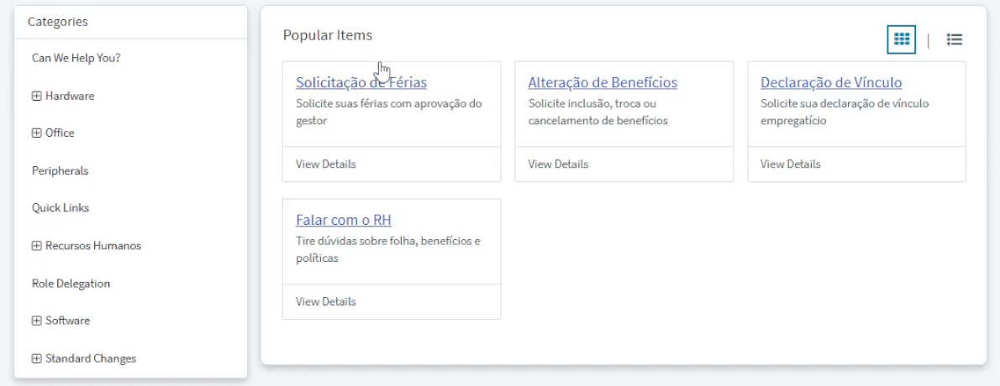
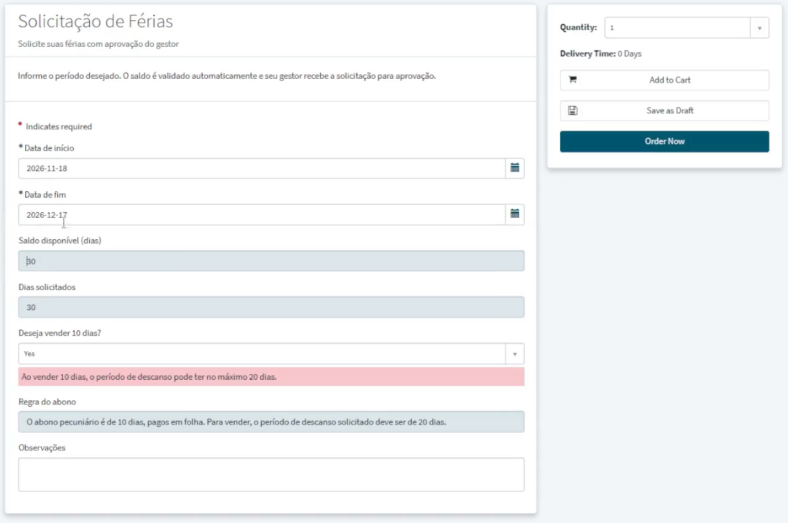
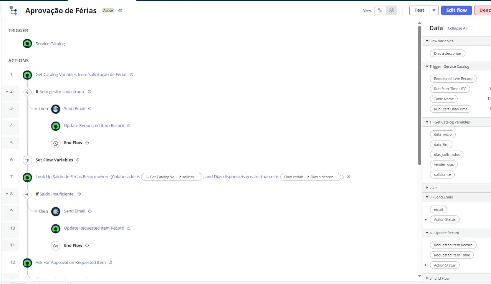
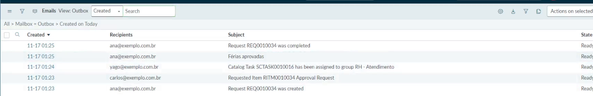
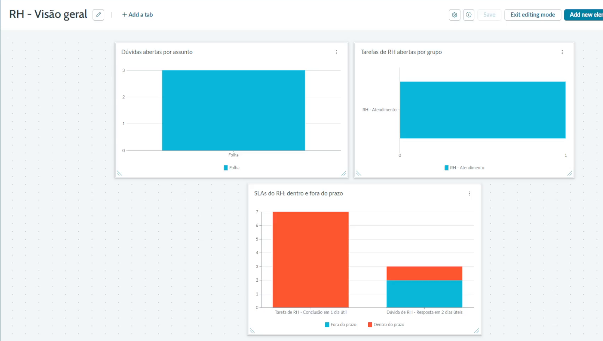
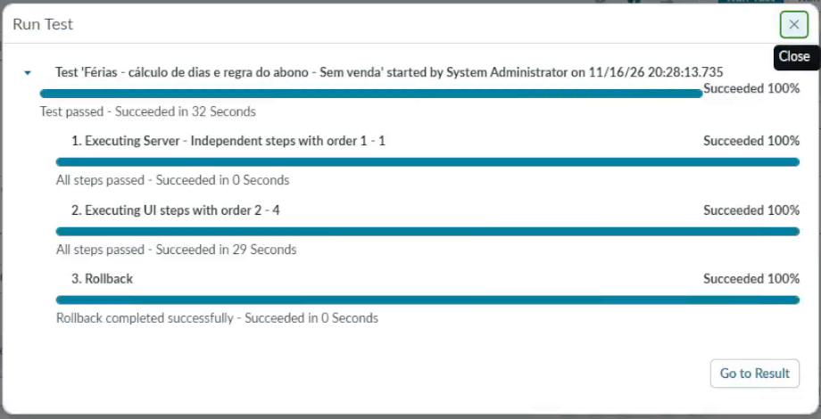
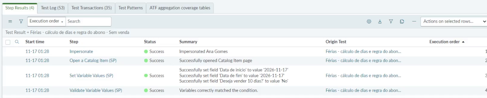

# 🧑‍💼 HR Self-Service Portal (ServiceNow)

> Autoatendimento de RH construído do zero na minha PDI do ServiceNow: catálogo de serviços, aprovação por gestor e por grupo, validação de saldo e tarefas para o RH, tudo automatizado com Flow Designer.


▶️ **[Assistir à demonstração (1min33s)](docs/video/demonstracao-90s.mp4)** · [Repositório no GitHub](https://github.com/Natch01/HR-Self-Service-Servicenow)

---

## 📌 Sobre o projeto

Sou iniciante em ServiceNow e criei este projeto para **aprender fazendo**, com um problema que existe em quase toda empresa:

- **Problema:** pedidos de férias, declarações e benefícios chegam ao RH por e-mail, sem prazo, sem rastreio e sem validação.
- **Solução:** o colaborador faz o pedido pelo catálogo, o sistema valida o que for possível, alguém aprova, o RH executa em uma tarefa e o colaborador é avisado no momento certo.

Escolhi construir tudo manualmente, sem templates prontos, porque queria entender cada peça e conseguir explicá-la depois.

**Sobre o nome "Portal":** o colaborador faz os pedidos pelo **Service Portal** padrão da plataforma (`/sp`), e acompanha pedidos e dúvidas em *My Requests*, onde também conversa com o RH. Os quatro itens foram testados lá e também na interface clássica. Ainda não há páginas ou widgets próprios; isso está nos próximos passos.



---

## 🎬 Como funciona

### Férias (aprovação do gestor + validação de saldo)

```
Colaborador vê o saldo no formulário e faz o pedido
(o envio é bloqueado se o abono for inválido ou o saldo não cobrir o pedido)
        │
        ▼
Colaborador tem gestor cadastrado? ──► não ──► e-mail avisando e fim do fluxo
        │
        ▼ (sim)
Sistema calcula os dias a descontar (dias pedidos + 10, se houver venda)
        │
        ▼
Sistema busca o saldo dele ──► saldo insuficiente? ──► e-mail avisando e fim do fluxo
        │
        ▼ (saldo ok)
O gestor do colaborador recebe a aprovação
        │
        ├── rejeitou ──► e-mail avisando o colaborador (saldo intacto)
        │
        ▼ (aprovou)
Tarefa para o grupo "RH - Atendimento"
        │
        ▼ (o flow espera o RH concluir)
Saldo é descontado + e-mail de confirmação
```

### Alteração de Benefícios (aprovação por grupo)

```
Colaborador faz o pedido (com anexo opcional)
        │
        ▼
Qualquer membro do grupo "RH - Benefícios" aprova ou rejeita
        │
        ├── rejeitou ──► e-mail avisando o colaborador (nenhuma tarefa é criada)
        │
        ▼ (aprovou)
Tarefa para o grupo "RH - Benefícios", com as variáveis do pedido
        │
        ▼ (o flow espera o RH concluir)
E-mail de conclusão para o colaborador
```

---

## 🧱 O que foi construído

### Aplicação
- **Scoped App** `HR Self-Service Portal` (escopo `x_1863045_hr_sel_1`).

### Acessos
| Item | Detalhe |
|---|---|
| Papel | `x_1863045_hr_sel_1.agent` |
| Grupos | `RH - Atendimento` e `RH - Benefícios` (o papel fica no **grupo**, não no usuário) |
| Usuários de teste | **Ana** (colaboradora), **Carlos** (gestor da Ana no campo *Manager*), **Yago** (agente de RH, membro dos dois grupos) |

### Tabelas
| Tabela | Estende | Campos principais |
|---|---|---|
| `Saldo de Férias` | — | `colaborador` (Reference → User), `dias_disponiveis` (Integer), `periodo_aquisitivo` (Date) |
| `Dúvida de RH` | `Task` | `assunto` (Choice: Folha, Benefícios, Políticas, Outros) |

Estender a `Task` me deu número, estado, atribuição e comentários de graça.

### Catálogo de serviços
Categoria **Recursos Humanos**, com as subcategorias *Férias e Ausências*, *Documentos* e *Benefícios*.

| Item | Variáveis | Observações |
|---|---|---|
| **Solicitação de Férias** | `saldo_disponivel`, `data_inicio`, `data_fim`, `dias_solicitados`, `vender_dias`, `aviso_abono`, `observacoes` | Saldo visível, cálculo automático de dias, validação do abono e do saldo |
| **Declaração de Vínculo** | `finalidade`, `idioma` | Select Box com opções |
| **Alteração de Benefícios** | `tipo_beneficio`, `tipo_alteracao`, `motivo`, `anexo` | Motivo obrigatório, aceita anexo |
| **Falar com o RH** (Record Producer) | `assunto`, `descricao_duvida` | Cria um registro em `Dúvida de RH`, já atribuído ao grupo `RH - Atendimento`, e confirma ao colaborador o número e o prazo |

Os três itens de catálogo têm também uma variável oculta `solicitante` (Reference → User, preenchida com o usuário logado). Ela existe por causa de uma limitação de escopo que explico nos aprendizados.

### Regras no formulário de férias
- **Catalog Client Scripts** (`onChange` em `data_inicio`, `data_fim` e `vender_dias`) calculam os dias entre início e fim, contando os dois extremos (de 01 a 05 são 5 dias), e preenchem `dias_solicitados`, que é somente leitura.
- O cálculo lê o formato de data do próprio usuário (`g_user_date_format`), então funciona tanto em `yyyy-MM-dd` quanto em `dd/MM/yyyy`.
- Se a data final for anterior à inicial, ou se o período não puder ser calculado, o campo é limpo e aparece um erro.
- **Regra do abono:** para vender 10 dias, o período solicitado precisa ter exatamente 20 dias. Com menos ou com mais, aparece uma mensagem de erro no campo.
- Um script **`onSubmit`** impede o envio quando o período é inválido, quando a regra do abono não é atendida ou quando o pedido passa do saldo. Os `onChange` avisam; este bloqueia.
- **Saldo visível:** ao abrir o formulário, um script `onLoad` consulta o servidor (`GlideAjax` → Script Include `SaldoFeriasAjax`) e mostra o saldo do colaborador em um campo somente leitura. O servidor decide de quem é o saldo (o usuário logado); o navegador não informa isso.
- A venda de dias abre em "No" por padrão, e a área genérica de anexos do portal fica oculta nos itens que não precisam dela.

O saldo é validado em duas camadas: o formulário avisa e bloqueia na hora, com os dois números ("este pedido usa 36 dias e você tem 30"), e o flow repete a verificação no servidor, para o caso de o saldo mudar depois da abertura do formulário ou de o pedido não vir do formulário.
- **Catalog UI Policy** mostra um aviso explicando o abono quando o usuário escolhe "Yes".



### Proteção do pedido depois de enviado
Na Alteração de Benefícios, uma **Catalog UI Policy** deixa as variáveis somente leitura na tarefa e no item solicitado, mas não no formulário de pedido. O colaborador preenche normalmente; depois de enviado, o RH consulta o pedido sem conseguir alterá-lo.

### Automação (Flow Designer)

Os três flows usam o trigger **Service Catalog**. Ele não filtra por item: quem liga o flow ao item é o próprio item, em *Process Engine*.

**Flow `Aprovação de Férias`**

| # | Etapa | O que faz |
|---|---|---|
| 1 | Get Catalog Variables | Lê datas, dias, abono e solicitante |
| 2 | If "Sem gestor cadastrado" | Entra quando o *Manager* do solicitante está vazio |
| 3 | ↳ Send Email | Avisa o colaborador e indica o *Falar com o RH* |
| 4 | ↳ Update Record | Encerra o pedido como *Closed Incomplete* |
| 5 | ↳ End Flow | Encerra; não há para quem enviar a aprovação |
| 6 | Set Flow Variables | Calcula **dias a descontar**: dias pedidos, mais 10 se houver venda |
| 7 | Look Up Record | Busca o registro de saldo **mais antigo** do colaborador com dias suficientes para o total |
| 8 | If "Saldo insuficiente" | Entra quando a busca volta vazia |
| 9 | ↳ Send Email | Avisa o colaborador |
| 10 | ↳ Update Record | Encerra o pedido como *Closed Incomplete* |
| 11 | ↳ End Flow | Encerra; o gestor não recebe nada |
| 12 | Ask For Approval | O **gestor do solicitante** aprova ou rejeita (regra *Approve or Reject*) |
| 13 | If "Aprovado pelo gestor" | |
| 14 | ↳ Create Catalog Task | Tarefa para `RH - Atendimento`, com **Wait**: o flow pausa até o RH concluir |
| 15 | ↳ Descontar Saldo de Férias | Custom Action (abaixo), recebendo o **mesmo registro** da etapa 7 e os dias da etapa 6 |
| 16 | ↳ Send Email | "Férias aprovadas" |
| 17 | ↳ Update Record | Encerra o pedido como *Closed Complete* |
| 18 | If "Rejeitado pelo gestor" | |
| 19 | ↳ Send Email | "Solicitação de férias não aprovada" |
| 20 | ↳ Update Record | Encerra o pedido como *Closed Incomplete* |

Decisões de design:
- **Etapa 6:** o total a descontar é calculado uma vez e usado em dois lugares (validação do saldo e desconto). Quem tira 20 dias e vende 10 consome 30 do saldo, e as duas contas precisam concordar.
- **Etapa 7:** em vez de buscar o saldo e comparar depois, a própria busca já filtra por "dias suficientes". Se não volta nada, o saldo é insuficiente. Ela ordena pelo período aquisitivo, para consumir primeiro o período mais antigo.
- **Etapa 12:** o aprovador vem do cadastro (`solicitante ▸ Manager`), sem nome fixo no flow.
- Cada situação tem um e-mail com assunto próprio (sem gestor, saldo insuficiente, rejeitado, aprovado). Olhando a Outbox, dá para saber em que ponto o flow parou.
- Todo caminho termina encerrando o pedido (veja *Encerramento do pedido*, mais abaixo).



**Custom Action `Descontar Saldo de Férias`:** criei uma ação própria com um passo de script (`GlideRecord`), porque o Flow Designer não subtrai valores direto no campo e o saldo é Integer enquanto `dias_solicitados` chega como texto. A ação recebe o registro de saldo que a etapa 7 validou (e não o colaborador) e o total calculado na etapa 6, converte os valores com `parseInt`, recusa o desconto se ele deixaria o saldo negativo e registra um aviso no log quando não desconta.

**Flow `Declaração de Vínculo`**

| # | Etapa | O que faz |
|---|---|---|
| 1 | Get Catalog Variables | Lê finalidade, idioma e solicitante |
| 2 | Create Catalog Task | "Emitir declaração de vínculo" para `RH - Atendimento`, com **Wait** |
| 3 | Send Email | "Sua declaração de vínculo está pronta", só depois que o RH conclui |
| 4 | Update Record | Encerra o pedido como *Closed Complete* |

**Flow `Alteração de Benefícios`**

| # | Etapa | O que faz |
|---|---|---|
| 1 | Get Catalog Variables | Lê tipo de benefício, tipo de alteração, motivo e solicitante |
| 2 | Set Flow Variables | Monta o texto "Plano de saúde - Inclusão" com os **rótulos** das opções |
| 3 | Ask For Approval | Aprovação pelo **grupo** `RH - Benefícios` (qualquer membro aprova ou rejeita) |
| 4 | If "Aprovado pelo RH" | |
| 5 | ↳ Create Catalog Task | Tarefa para `RH - Benefícios`, com **Wait** e com as variáveis do pedido visíveis no formulário |
| 6 | ↳ Send Email | "Sua alteração de benefício foi concluída" |
| 7 | ↳ Update Record | Encerra o pedido como *Closed Complete* |
| 8 | If "Rejeitado pelo RH" | |
| 9 | ↳ Send Email | "Sua solicitação de alteração de benefício não foi aprovada", indicando o item *Falar com o RH* |
| 10 | ↳ Update Record | Encerra o pedido como *Closed Incomplete* |

A etapa 2 nasceu de um problema que só apareceu no teste (aprendizado 9). O script dela é curto:

```javascript
var ritm = fd_data.trigger.request_item;
return ritm.variables.tipo_beneficio.getDisplayValue() + ' - ' +
       ritm.variables.tipo_alteracao.getDisplayValue();
```

O texto é montado uma vez e reutilizado na tarefa e nos dois e-mails. Se o formato mudar, mudo em um lugar só.

### Encerramento do pedido

Os flows faziam tudo e terminavam sem fechar o item solicitado (RITM). No portal, o colaborador via todos os pedidos como *Open*, inclusive os concluídos e os rejeitados. Agora cada caminho termina com um **Update Record** no RITM, alterando dois campos:

| Desfecho | State | Stage |
|---|---|---|
| Concluído pelo RH | Closed Complete | Completed |
| Rejeitado, sem saldo ou sem gestor | Closed Incomplete | Request Cancelled |

O **State** é o que o colaborador lê. O **Stage** é o que faz a plataforma fechar também o pedido pai (REQ): só com o State alterado, o RITM fechava e o REQ continuava aberto. O valor do Stage de cancelamento é informado por script (`return 'Request Cancelled';`), porque a lista de opções desse campo mistura etapas de vários processos e repete o mesmo nome.

### Prazos de atendimento (SLA)

| SLA | Onde vale | Prazo | Relógio |
|---|---|---|---|
| Dúvida de RH - Resposta em 2 dias úteis | Tabela `Dúvida de RH` | 18 horas úteis | Começa ao abrir, pausa em *Pending*, para ao fechar |
| Tarefa de RH - Conclusão em 1 dia útil | `Catalog Task` dos grupos `RH - Atendimento` e `RH - Benefícios` | 9 horas úteis | Começa ao criar a tarefa, pausa em *Pending*, para ao fechar |

Os dois usam a agenda *8-5 weekdays excluding holidays*. O prazo conta só o tempo em que o RH está trabalhando: um pedido feito às 19h não consome nada até as 8h do dia útil seguinte. O RH vê o prazo dentro do próprio registro da dúvida, na lista *Task SLAs*.

### Cadeia de avisos de um pedido

Um pedido de férias aprovado, visto pela caixa de saída: pedido criado, aprovação para o gestor, tarefa para o RH e a confirmação para a colaboradora.



### Acompanhamento das dúvidas

Depois de enviar uma dúvida, o colaborador a encontra em *Requests*, no portal, ao lado dos pedidos de catálogo. Ao abrir, vê a conversa com o RH e pode responder. Quatro peças fazem isso funcionar:

| Peça | O que faz |
|---|---|
| **ACL de leitura** | Libera a leitura quando `opened_by` é o usuário logado. Cada um vê só as próprias dúvidas |
| **3 ACLs de escrita** | (1) o autor pode escrever no registro; (2) todos os campos (`*`) exigem o papel `agent`; (3) o campo *Additional comments* aceita o RH ou o autor |
| **My Request Filter** | Registro de configuração que inclui a tabela `Dúvida de RH` na página *Requests* do Service Portal |
| **Notificação** `Dúvida de RH - nova resposta` | Avisa o autor por e-mail quando alguém comenta |

O formulário da dúvida ganhou o campo *Additional comments* (visível ao colaborador) e o histórico de atividades. As *Work notes* continuam internas: o colaborador não vê o campo nem as anotações.

São três regras de escrita porque a plataforma exige passar pela regra da **tabela** e pela regra do **campo**. Liberar só a tabela deixaria o colaborador alterar tudo, inclusive o estado da própria dúvida. A regra do `*` tranca os campos, e a do comentário, por ser mais específica, abre a única exceção.

### Notificações
Os avisos ao colaborador saem dos flows, no momento em que cada coisa acontece (aprovado, rejeitado, concluído). Desativei a notificação padrão *Request approved*, que avisava "seu pedido foi aprovado" no instante da criação, antes de qualquer aprovação real. Essa é uma configuração da instância, não do app (veja *Como instalar*).

### Scripts (JavaScript)

Por trás das telas e dos flows há JavaScript, no navegador e no servidor. Cada script tem uma função:

| Script | Onde roda | O que faz |
|---|---|---|
| Cálculo de dias (3 *Catalog Client Scripts* `onChange`) | Navegador | Ao mudar as datas ou a venda de dias, calcula o período no formato de data do usuário, preenche `dias_solicitados` e mostra o erro do abono |
| *Bloquear envio inválido* (`onSubmit`) | Navegador | Cancela o envio se o período for inválido, se a regra do abono não for atendida ou se o pedido passar do saldo |
| *Carregar saldo disponível* (`onLoad`) | Navegador | Pede o saldo ao servidor por `GlideAjax` e mostra no formulário |
| `SaldoFeriasAjax` (*Script Include*) | Servidor | Devolve o saldo do usuário logado. O filtro é fixo no servidor, então ninguém consulta o saldo de outra pessoa |
| *Descontar Saldo de Férias* (*Custom Action*) | Servidor | Abre o registro de saldo validado pelo flow, desconta os dias, recusa saldo negativo e registra aviso no log |
| Dias a descontar (script no flow de férias) | Servidor | Soma os 10 dias vendidos ao total antes de validar e descontar |
| Resumo do benefício (script no flow de benefícios) | Servidor | Monta o texto com os rótulos das opções (`getDisplayValue`), usado na tarefa e nos e-mails |
| Estágio de encerramento (script nos três flows) | Servidor | Informa o valor exato do campo *Stage* para a plataforma fechar o pedido |
| *Falar com o RH* (*Record Producer*) | Servidor | Preenche a dúvida, atribui o grupo do RH e devolve a mensagem de confirmação |
| Regras de acesso (scripts de ACL) | Servidor | Liberam leitura e comentário da dúvida só para quem a abriu, além do RH |

### Painel do RH

Painel **RH - Visão geral**, criado no Platform Analytics e compartilhado com o papel `agent`. Três gráficos, cada um para uma pergunta:

| Gráfico | Pergunta | Como é montado |
|---|---|---|
| Dúvidas abertas por assunto | Do que os colaboradores mais perguntam? | Tabela `Dúvida de RH`, só as ativas, agrupadas por assunto |
| Tarefas de RH abertas por grupo | Onde está a fila? | `Catalog Task` ativas cujo grupo começa com "RH -", agrupadas por grupo |
| SLAs do RH: dentro e fora do prazo | Estamos cumprindo o prazo? | `Task SLA` dos dois SLAs do projeto, com uma série para cada situação, agrupadas por SLA |

O terceiro gráfico usa duas fontes de dados sobre a mesma tabela, uma com *Has breached* verdadeiro e outra com falso, cada uma com o seu nome. Agrupar direto por esse campo daria uma legenda "true/false", que não diz nada a quem abre o painel.



### Testes automatizados (ATF)

Três testes no Automated Test Framework, todos rodando no **Service Portal** como a Ana:

| Teste | O que faz | Resultado esperado |
|---|---|---|
| Cálculo de dias | Abre a Solicitação de Férias, preenche as datas e confere `dias_solicitados` | O número de dias bate com o período |
| Com venda, bloqueado | Preenche um período diferente de 20 dias, marca a venda e tenta enviar | O navegador **bloqueia** o envio |
| Com venda, aceito | Preenche 20 dias, marca a venda e envia | O pedido é criado |

Cada teste segue a mesma sequência: *Impersonate* → *Open a Catalog Item (SP)* → *Set Variable Values (SP)* → *Validate Variable Values (SP)* → *Order a Catalog Item (SP)*. No fim, o ATF desfaz o que criou (rollback), então o saldo e os pedidos não mudam.





### Navegação
Menu **HR Self-Service** no navegador de aplicações, com os módulos *Saldo de Férias* e *Dúvidas de RH*, restrito aos papéis `agent` e `admin` do app. O colaborador comum não vê o menu.

---

## ✅ Como testei

Usei **Impersonate User** para viver cada papel (Ana, Carlos e Yago). Confiro os e-mails na **Outbox** e as execuções em *Flow Designer → Operations → Executions*.

### Férias

| Cenário | Resultado esperado | Resultado |
|---|---|---|
| Pedido de 5 dias, aprovado, tarefa fechada | Saldo 30 → 25 e e-mail de confirmação | ✅ |
| Pedido de 31 dias | E-mail de saldo insuficiente, gestor não recebe nada | ✅ |
| Pedido de 9 dias | Segue para aprovação | ✅ |
| Gestor rejeita | E-mail para a Ana e saldo intacto | ✅ |
| Reteste após mudar a Custom Action: 5 dias, aprovado, tarefa fechada | Saldo 30 → 25, alterado pelo flow, sem avisos no log | ✅ |
| Datas em `dd/MM/yyyy`: 12/11 a 16/11, vendendo 10 dias | 5 dias e erro do abono | ✅ |
| Datas em `yyyy-MM-dd` (regressão): 10/11 a 17/11 | 8 dias | ✅ |
| Aprovador dinâmico: pedido da Ana | Aprovação vai para o Carlos, lido do campo *Manager* dela | ✅ |
| Colaborador sem gestor cadastrado | E-mail "Não foi possível encaminhar", nenhuma aprovação criada | ✅ |
| Envio com 5 dias e venda de 10 | Formulário bloqueia o envio, com mensagem no campo | ✅ |
| 20 dias + venda, saldo 25 | Saldo insuficiente (precisa de 30); gestor não recebe nada | ✅ |
| 20 dias + venda, saldo 30, aprovado e fechado | Saldo 30 → 0 | ✅ |
| 5 dias sem venda, saldo 30 (regressão) | Saldo 30 → 25 | ✅ |

O teste dos 9 dias existe por um motivo específico. `dias_solicitados` é texto, e comparando como texto `"9"` é **maior** que `"30"`, porque a comparação é feita caractere a caractere. Se o flow comparasse assim, um pedido de 9 dias seria barrado por "saldo insuficiente" com 30 dias disponíveis. Como ele seguiu para aprovação, a comparação está sendo numérica.

### Declaração de Vínculo

| Cenário | Resultado esperado | Resultado |
|---|---|---|
| Pedido da Ana, tarefa fechada pelo RH | E-mail "declaração pronta" só depois que o RH conclui | ✅ |

**Validação do `Wait`:** a tarefa foi criada às `11:52:12` e o e-mail saiu às `11:52:45`, 33 segundos depois, exatamente quando fechei a tarefa como Yago. O flow pausa e espera o RH, em vez de disparar tudo de uma vez. A lista da Outbox só mostra minutos, então confirmei abrindo cada registro.

### Alteração de Benefícios

| Cenário | Resultado esperado | Resultado |
|---|---|---|
| Pedido com anexo, aprovado pelo grupo, tarefa fechada | Aprovação chega ao Yago; tarefa em `RH - Benefícios` com variáveis e anexo; e-mail só após o fechamento | ✅ |
| Pedido rejeitado pelo grupo | E-mail de rejeição para a Ana; nenhuma tarefa criada | ✅ |
| Rótulos no texto | Tarefa e e-mails mostram "Vale-transporte - Cancelamento", não `vt-cancelamento` | ✅ |
| Variáveis na tarefa (como Yago) | Somente leitura | ✅ |
| Formulário de pedido (como Ana) | Continua editável | ✅ |
| Anexo na tarefa, com a política ativa (como Yago) | Arquivo acessível, sem opção de alterar ou apagar | ✅ |

**Validação do `Wait`:** no primeiro pedido, a tarefa foi criada às `02:54` e o e-mail de conclusão só saiu às `19:08`, quando fechei a tarefa. Dezesseis horas de intervalo, o mesmo comportamento dos 33 segundos da Declaração.

### Falar com o RH e SLAs

| Cenário | Resultado esperado | Resultado |
|---|---|---|
| Ana envia uma dúvida | Volta ao catálogo com a mensagem "Sua dúvida DVI… foi registrada. O RH responde em até 2 dias úteis" | ✅ |
| Dúvida criada | Atribuída ao grupo `RH - Atendimento`, com o SLA de 2 dias úteis anexado | ✅ |
| Ciclo do SLA na dúvida | *In progress* → *Paused* (Pending) → *In progress* → *Completed* (fechada) | ✅ |
| Tarefa de benefícios criada após aprovação | SLA de 1 dia útil anexado, 9 horas restantes | ✅ |
| Pedido feito fora do expediente | Relógio do SLA parado (0 segundos consumidos) | ✅ |

### Notificações

| Cenário | Resultado esperado | Resultado |
|---|---|---|
| Pedido novo, depois de desativar *Request approved* | Ana recebe "was created" e não recebe mais "was approved" | ✅ |

### Portal do colaborador (`/sp`)

| Cenário | Resultado esperado | Resultado |
|---|---|---|
| Catálogo como Ana | Categoria *Recursos Humanos* com as três subcategorias e os quatro itens | ✅ |
| Solicitação de Férias | Cálculo de dias, erro do abono e bloqueio do envio funcionam como na interface clássica | ✅ |
| Alteração de Benefícios | Formulário abre, campo obrigatório sinalizado, anexo funciona | ✅ |
| Falar com o RH | Confirmação com o número da dúvida e o prazo | ✅ |
| *My Requests* | Ana vê os próprios pedidos | ✅ |
| Saldo no formulário | Campo *Saldo disponível* mostra 30 para a Ana (usuária sem papel do app) | ✅ |
| 36 dias com saldo 30 | Envio bloqueado: "este pedido usa 36 dias e você tem 30 disponíveis" | ✅ |

### Encerramento do pedido

| Cenário | Resultado esperado | Resultado |
|---|---|---|
| Declaração concluída pelo RH | Pedido sai de *Open* e aparece como *Closed Complete* no portal | ✅ |
| Benefícios rejeitado pelo grupo | Pedido aparece como *Closed Incomplete* no portal | ✅ |
| Férias sem saldo | Pedido encerrado (confirmado pela notificação de encerramento na Outbox) | ✅ |
| Férias aprovadas e concluídas | *Closed Complete* | ✅ |
| Férias rejeitadas pelo gestor | *Closed Incomplete* | ✅ |
| Férias sem gestor | *Closed Incomplete* | ✅ |
| Benefícios aprovado e concluído | *Closed Complete* | ✅ |

### Dúvidas no portal

| Cenário | Resultado esperado | Resultado |
|---|---|---|
| Ana abre a lista de dúvidas | Vê as três que abriu; a do admin não aparece | ✅ |
| Ana abre uma dúvida | Registro abre, sem cadeado | ✅ |
| Yago responde em *Additional comments* e anota em *Work notes* | Ana vê a resposta e **não** vê a anotação interna | ✅ |
| Página *Requests* do portal | A dúvida aparece junto com os pedidos e abre com a conversa | ✅ |
| Ana responde pelo portal | Caixa de mensagem disponível; comentário publicado | ✅ |
| Ana no formulário clássico | Só o comentário é editável; State, Assunto e Description bloqueados | ✅ |
| Yago depois das regras novas (regressão) | Continua editando todos os campos | ✅ |
| Yago comenta | E-mail "Sua dúvida DVI… recebeu uma resposta" para a Ana | ✅ |
| Ana comenta | Ana não recebe e-mail do próprio comentário | ✅ (após ajuste, veja o aprendizado 39) |

### Painel do RH

| Cenário | Resultado esperado | Resultado |
|---|---|---|
| Dúvidas abertas por assunto | 3 em *Folha*; a dúvida fechada de *Benefícios* não entra | ✅ |
| Tarefas por grupo, sem tarefa de RH aberta | Gráfico vazio; tarefas de outros grupos da instância não aparecem | ✅ |
| Tarefas por grupo, depois de um pedido de declaração | Uma barra *RH - Atendimento* com 1 | ✅ |
| SLAs dentro e fora do prazo | Tarefas: 6 dentro, 0 fora. Dúvidas: 1 dentro, 2 fora (as duas abertas há dias) | ✅ |
| Painel visto pelo Yago | Abre com os três gráficos preenchidos | ✅ |

### Testes automatizados (ATF)

| Cenário | Resultado esperado | Resultado |
|---|---|---|
| Cálculo de dias | Validação do período passa; rollback concluído | ✅ |
| Valor esperado errado de propósito | O teste **falha** (prova que ele detecta diferença) | ✅ |
| 29 dias com venda | "Browser blocks submission of form to server" | ✅ |
| 20 dias com venda | "Item was successfully ordered"; pedido apagado no rollback | ✅ |

### Navegação e acesso

| Cenário | Resultado esperado | Resultado |
|---|---|---|
| Yago (papel `agent` pelo grupo) busca o menu | Vê *HR Self-Service* com os dois módulos | ✅ |
| Ana (sem papel do app) busca o menu | Não vê o menu | ✅ |

---

## 🧠 O que aprendi (os erros também contam)

Esta é a parte de que mais me orgulho, porque foi onde realmente aprendi.

### Catálogo e formulários

1. **O `Name` da variável é o que vale, não o rótulo.** Meu script usava um nome diferente do nome real da variável, que era `vender_dias`. A validação nunca disparava. Descobri com um `alert()` temporário e passei a conferir o *Name* depois de salvar.
2. **UI Policy sem Action não faz nada.** Criei a política e esqueci a *Catalog UI Policy Action*. O aviso só apareceu depois que adicionei.
3. **A mesma UI Policy pode valer em contextos diferentes.** As opções *Applies on a Catalog Item view*, *on Catalog Tasks* e *on Requested Items* decidem onde a regra age. Foi assim que deixei as variáveis somente leitura para o RH sem travar o formulário do colaborador.
4. **"Hidden" esconde do formulário, não do resumo.** Minha variável oculta `solicitante` aparece no resumo que o aprovador vê. Neste caso ajuda (ele vê quem pediu), mas são controles diferentes: existe a opção *Visible on Summaries* para isso.
5. **O valor de um Yes/No no client script chega como `"Yes"`/`"No"`**, não como `true`/`false`. Meu script trata os dois formatos.

### Dados

6. **Nada de `sys_` nos meus campos.** Esse prefixo é reservado ao sistema. Corrigi antes de criar dados em cima.
7. **Tipos importam.** Meus campos nasceram como String; precisei trocar para Reference, Integer e Date para o flow funcionar.

### Flow Designer

8. **A regra de aprovação precisa cobrir a rejeição.** Com a regra *Approve*, a rejeição do gestor não chegava ao meu If. Com *Approve or Reject*, passou a funcionar.
9. **Pill de Choice entrega o valor, não o rótulo.** A primeira tarefa de benefícios saiu como `Alteração de benefício:saude-inclusao`: o valor interno no lugar de "Plano de saúde", e sem os espaços que eu tinha digitado em volta dos pills. Resolvi com `getDisplayValue()` em uma Flow Variable.
10. **Flow Variable evita repetir lógica.** O mesmo texto era usado em três lugares. Montar uma vez e reutilizar deixou a correção em um ponto só.
11. **Quando o Flow não faz a conta, uma Custom Action com script resolve.** Foi o caso do desconto do saldo.
12. **Escopo do app limita o acesso a tabelas globais.** A tabela `sc_req_item` não aparecia nos seletores do Flow Designer e o pill do RITM não expandia. Contornei com a variável oculta `solicitante`. Mais tarde descobri que, por script, a leitura do RITM funciona (é o que a etapa 2 do flow de benefícios faz).
13. **Aprovar por grupo é mais flexível que por pessoa.** Se a equipe mudar, ajusto os membros do grupo e não toco no flow.
14. **O Send Email aceita um registro de usuário no "To".** Passei o pill `solicitante` direto e a plataforma resolveu o endereço.

### Plataforma e acessos

15. **Papel no grupo, não no usuário.** Fica mais fácil de escalar e de auditar.
16. **Cada papel enxerga um menu diferente.** O gestor e o agente de RH precisaram de papéis adicionais, além do papel do app, para acessar aprovações e tarefas pelo menu normal.
17. **A Outbox só mostra minutos.** Para provar a ordem dos eventos, abro cada registro e comparo os segundos.
18. **As notificações padrão do catálogo podem contradizer as minhas.** No teste de rejeição, a Ana recebeu "Request was approved" (automática, do REQ) e, um minuto depois, o meu e-mail "não foi aprovada". Só vi isso porque olhei a Outbox inteira, e virou prioridade da fase de notificações.

### Erros que não avisam

19. **Um `NaN` atravessa as validações em silêncio.** Com a data em `dd/MM/yyyy`, o `new Date()` do meu script não entendia o valor e o campo de dias mostrava `NaN`. Pior: a regra do abono era pulada, porque `NaN < 20` e `NaN > 20` são os dois falsos. O pedido podia ser enviado assim. Reproduzi o problema antes de corrigir, passei a ler o formato do usuário e adicionei uma checagem explícita de `isNaN`.
20. **Validar e agir precisam olhar para o mesmo registro.** Meu flow validava um registro de saldo e a ação buscava outro por conta própria. Com um único registro por colaborador, dava no mesmo; com dois, não daria. Agora a ação recebe exatamente o registro validado.
21. **Script que falha calado é difícil de depurar.** A versão antiga da ação simplesmente não fazia nada quando algo dava errado. Um `gs.warn` com o motivo custa uma linha e deixa rastro no log.
22. **Existem dois "Application Menu", e eu tinha criado o errado.** Meu menu estava ativo, com papéis e módulos certos, e não aparecia para ninguém. Passei por cache, logout e papéis sem resultado. A causa só apareceu quando procurei o registro na tabela dos menus do navegador (`sys_app_application`) e ele não estava lá: tinha sido criado na tabela da interface móvel antiga (`sys_ui_application`), que tem o mesmo nome na tela. A pista estava no formulário o tempo todo (um campo *Name* onde o menu de desktop tem *Title*). Recriei no tipo certo e apaguei o antigo. Lição: quando a configuração parece certa e nada funciona, conferir se o registro está onde a plataforma vai procurá-lo.
23. **Testar com o usuário que não tem papel nenhum.** O *Falar com o RH* funcionava nos meus testes como admin. Como Ana, o envio terminava em uma tela de cadeado: a dúvida era criada, mas o redirecionamento levava a um registro que ela não pode ler. Troquei o redirecionamento pelo catálogo, com uma mensagem de confirmação.
24. **Um registro sem grupo responsável não tem dono.** As dúvidas eram criadas sem *Assignment group*. Com SLA e sem responsável, o prazo existiria e ninguém saberia que precisava cumpri-lo.

### SLAs e configuração da instância

25. **SLA conta horas úteis, e "um dia" depende da agenda.** A conta inicial considerava 8 horas por dia; a agenda *8-5* conta 9. O próprio formulário mostra quando um SLA iniciado agora venceria, e foi por esse aviso que percebi o erro antes de salvar.
26. **No construtor de condições, o OR da linha e o "Add OR Clause" criam lógicas diferentes.** O primeiro mantém as outras condições valendo (`ativo E (grupo A OU grupo B)`); o segundo abre um bloco independente, onde o "ativo" deixa de valer.
27. **Aprovação por grupo gera um registro pai e um por membro.** Quem aprova é o membro, pela aprovação individual; o registro do grupo só acompanha.
28. **Nem toda mudança viaja com o app.** Desativar uma notificação padrão ou ajustar o fuso é configuração Global da instância. Fiz essas mudanças no escopo Global de propósito e documentei na instalação, em vez de deixá-las escondidas.

### Testes

29. **`onChange` avisa, `onSubmit` decide.** Minhas validações mostravam o erro e deixavam enviar. O que bloqueia de fato é o retorno do `onSubmit`: `false` cancela o envio.
30. **O estado dos dados de teste também é parte do teste.** Depois de testar o caso "sem gestor", esqueci de devolver o gestor da Ana, e os pedidos seguintes pareciam um erro novo. O assunto do e-mail mostrou que era o bloco "sem gestor" agindo corretamente. Passei a conferir o cenário antes de cada teste e a dar um assunto próprio a cada e-mail do flow.

### Portal e experiência do colaborador

31. **Testar pela tela de quem usa.** Todos os meus testes olhavam e-mails, tarefas e saldo, e passavam. Só quando abri *My Requests* como a Ana vi que nenhum pedido fechava: os flows terminavam sem encerrar o RITM. O defeito existia desde o primeiro flow.
32. **State e Stage são campos diferentes, e o REQ segue o Stage.** Alterar só o State fechou o RITM e deixou o pedido pai aberto. Com o Stage na etapa final, a plataforma fechou o REQ sozinha.
33. **Lista com nomes repetidos: informar o valor, não escolher o rótulo.** O campo Stage oferecia "Cancelled" (de outro processo) e três ou quatro opções "Request Cancelled" idênticas. A que escolhi não era a que o catálogo reconhece. Resolvi informando o valor por script.
34. **O formulário não conhece o servidor.** Para mostrar o saldo antes do envio, precisei de um Script Include chamado por `GlideAjax`. A plataforma recomenda `GlideRecordSecure` e uma ACL por papel nesse tipo de script; mantive `GlideRecord` porque o filtro é fixo no servidor (o usuário logado) e todo colaborador precisa ver o próprio saldo. É uma escolha consciente, registrada nas limitações.
35. **Validar cedo e validar de novo.** Avisar no formulário melhora a experiência; garantir a regra é papel do servidor. O bloqueio no envio não substitui a verificação do flow.

### Acesso e conversa

36. **Para escrever em um campo, é preciso passar por duas regras: a da tabela e a do campo.** Por isso a resposta do colaborador pediu três ACLs, e não uma. A regra mais específica (o campo de comentário) vale no lugar da geral (`*`), então precisa liberar também o RH.
37. **Dar um canal antes de dar acesso não adianta, e o contrário também não.** Liberei a leitura e só então vi que o formulário não tinha onde o RH responder: havia apenas *Work notes*, que é interno.
38. **Configurar antes de construir.** Para a dúvida aparecer em *Requests*, bastou um registro em *My Request Filters*, copiando o padrão do filtro de Incident. Não precisei criar widget nem página.
39. **Testar também o que não deve acontecer.** A notificação de nova resposta chegava à Ana até quando o comentário era dela. Só percebi porque o teste previa "nenhum e-mail" e a Outbox mostrou dois. A causa era a opção *Send to event creator*, que precisei desmarcar.

### Painel e leitura de dados

40. **A prévia do filtro é o melhor revisor.** Meu filtro de tarefas ficou "ativas **ou** dos grupos de RH", quando eu queria "**e**". O gráfico parecia razoável; a prévia mostrava uma tarefa de outro setor e várias tarefas fechadas. Reescrevi sem OR, com "grupo começa com RH -".
41. **Gráfico vazio pode ser filtro certo.** Depois da correção não sobrou nenhuma tarefa de RH aberta, e o gráfico ficou em branco. Para saber se era ausência de dados ou filtro quebrado, criei uma tarefa e vi a barra aparecer.
42. **Estágio do SLA não é o mesmo que prazo cumprido.** Um SLA estourado continua "In progress" enquanto o registro está aberto. Quem diz se o prazo foi cumprido é o campo *Has breached*.
43. **Um painel é lido por quem não sabe o que há por trás.** "true" e "false" na legenda eram corretos e inúteis. Dei nome às séries ("Dentro do prazo", "Fora do prazo") e agrupei pelo SLA, e o gráfico passou a mostrar onde está o problema: nas dúvidas, não nas tarefas.

### Testes automatizados

44. **Um teste que nunca falha não prova nada.** Antes de confiar no primeiro teste, coloquei um valor esperado errado para vê-lo ficar vermelho.
45. **O ATF tem duas famílias de passos de catálogo, e elas não se misturam.** Abri o item com o passo do portal, *(SP)*, e tentei enviar com o passo da interface clássica. O erro foi "There is no item currently open": o segundo passo procurava o item em outro lugar.
46. **Teste vermelho quer dizer "diferente do esperado", não "sistema quebrado".** Copiei o teste de bloqueio para criar o de sucesso e esqueci de trocar a expectativa. O formulário aceitou o pedido válido, como devia, e o teste falhou porque esperava um bloqueio. O erro estava no teste.
47. **Um teste deve definir tudo de que depende.** O campo de venda vinha preenchido por padrão. Passei a informar o valor dele em cada teste, em vez de confiar no padrão do formulário.

---

## ⚠️ Limitações conhecidas (e honestas)

**Férias**
- **A regra do abono é validada só no formulário.** O `onSubmit` bloqueia o envio inválido, mas o flow não repete a verificação. Um pedido criado por outro caminho (API, por exemplo) não passaria por ela.
- **Sem gestor, o pedido é encerrado.** O colaborador é avisado e precisa pedir de novo depois de regularizar o cadastro. Não há encaminhamento automático para o RH nem aprovador substituto.
- **O saldo é validado no pedido e descontado no fechamento.** Dois pedidos feitos em sequência passam os dois pela validação. O saldo não fica mais negativo (a ação recusa o segundo desconto e avisa no log), mas o segundo pedido já terá sido aprovado. O ideal seria reservar o saldo no momento do pedido.
- **Um pedido não é dividido entre períodos aquisitivos.** O flow usa o período mais antigo que, sozinho, tenha saldo suficiente. Testei com um único período por colaborador.
- **O saldo do formulário é o da abertura da página.** Se ele mudar antes do envio, quem barra é o flow, e o colaborador é avisado por e-mail.
- **A consulta de saldo usa `GlideRecord` sem ACL própria.** Cada usuário só recebe o próprio saldo, porque o filtro é fixo no servidor, mas o caminho mais formal seria uma ACL de leitura do próprio registro com `GlideRecordSecure`.
- **O cálculo de dias foi testado em dois formatos de data** (`yyyy-MM-dd` e `dd/MM/yyyy`). Os demais formatos da plataforma seguem a mesma lógica, mas não testei um a um.
- **O formulário aceita datas no passado.** Não há verificação de que o início das férias é futuro.
- **O teste de bloqueio do abono não isola a regra.** Com 29 dias e venda, o pedido também passa do saldo (39 > 30), então a regra do saldo barraria o envio mesmo que a do abono quebrasse. Um período de 15 dias isolaria o abono.
- **Regras da CLT além do abono não estão implementadas** (fracionamento em até 3 períodos, mínimo de 14 dias em um deles e de 5 nos demais).
- **O mesmo código está repetido em três client scripts.**

**Benefícios**
- **A UI Policy protege a interface, não o dado.** Ela bloqueia o formulário, mas não impede alteração por script ou API. Proteção de verdade seria com ACL.
- **Quem aprova também executa.** O Yago é o único membro do `RH - Benefícios`, então aprova o pedido e fecha a tarefa. Num cenário real, seriam pessoas diferentes.

**Geral**
- **O `solicitante` é quem está logado**, não o campo *Requested for*. Pedidos feitos em nome de outra pessoa usariam o usuário errado.
- **O RH não é avisado quando o colaborador responde.** A notificação de nova resposta vai só para o autor da dúvida. O agente precisa abrir o registro para ver.
- **O acesso à dúvida segue quem a abriu** (`opened_by`). Uma dúvida aberta em nome de outra pessoa não apareceria para ela.
- **O colaborador ainda pode comentar em uma dúvida já fechada**, e isso não a reabre.
- **A notificação padrão *Request completed* contradiz os meus e-mails nos pedidos que não deram certo.** Agora que os pedidos fecham, ela avisa "was completed" em todo encerramento, inclusive ao lado do meu e-mail de saldo insuficiente. Ainda não a desativei.
- **As demais notificações padrão do catálogo continuam ativas e em inglês** ("Request was created", avisos ao aprovador e ao grupo). São úteis, mas não seguem o idioma dos meus e-mails.
- **Os SLAs medem o prazo, mas não avisam ninguém** quando ele está perto de vencer. O painel mostra o atraso depois que ele aconteceu.
- **O painel mostra contagens, não tendência.** Não há série histórica nem tempo médio de resposta.
- **No gráfico de SLAs, as cores ficaram invertidas** em relação ao que se espera (vermelho para "dentro do prazo"). É só a ordem das séries; falta ajustar.
- **O papel `itil`** que dei ao grupo de RH é amplo demais para um cenário real.
- Os e-mails na PDI ficam na **Outbox**; não são entregues de verdade.

---

## 🗺️ Próximos passos

- [x] Estrutura de acessos, tabelas e catálogo
- [x] Flow de aprovação de férias, testado
- [x] Flow da **Declaração de Vínculo**, testado
- [x] Flow da **Alteração de Benefícios** (aprovação por grupo), testado
- [x] Corrigir o desconto do saldo (registro certo e proteção contra saldo negativo)
- [x] Corrigir o cálculo de datas para o formato do usuário
- [x] **Notificações**: desativada a padrão que confundia o colaborador
- [x] **SLAs** para dúvidas e tarefas de RH
- [x] Menu de navegação e confirmação no *Falar com o RH*
- [x] Aprovador dinâmico (Manager do solicitante), com tratamento para quem não tem gestor
- [x] Abono: bloqueio no envio (`onSubmit`) e desconto dos dias vendidos
- [x] **Portal do colaborador (parte 1)**: itens testados no Service Portal, pedidos encerrados com o estado certo, saldo visível e validado no formulário
- [x] **Portal do colaborador (parte 2)**: o colaborador lê as próprias dúvidas, conversa com o RH pelo portal e é avisado das respostas
- [x] Painel do RH com três gráficos (Platform Analytics)
- [x] Primeiros testes automatizados (ATF): cálculo de dias e regra do abono no portal
- [ ] Ampliar o ATF para os flows (aprovação, rejeição, saldo) e para os outros itens

---

## 🛠️ Tecnologias

`Scoped App` · `JavaScript` · `Service Catalog` · `Catalog Client Script` · `Catalog UI Policy` · `Record Producer` · `Flow Designer` · `Flow Variables` · `Custom Action` · `GlideRecord` · `Script Include` · `GlideAjax` · `Service Portal` · `ACL` · `Notification` · `Platform Analytics` · `ATF` · `SLA Definition` · `Application Menu`

---

## ▶️ Como instalar


1. Em uma PDI, abra o **Studio** e escolha **Import from Source Control**.
2. Informe a URL deste repositório e uma credencial do GitHub.
3. Depois de importar, crie os dados de teste, que **não vêm com o app**:
   - usuários (colaborador, gestor e agente de RH) e os grupos `RH - Atendimento` e `RH - Benefícios`, com o papel `x_1863045_hr_sel_1.agent` nos grupos;
   - um registro em `Saldo de Férias` para o colaborador;
   - o campo **Manager** preenchido no cadastro do colaborador (é dele que sai o aprovador das férias).
4. Ajuste as configurações da instância, que também **não vêm com o app**:
   - desative a notificação padrão **Request approved** (tabela `sc_request`), para o colaborador não receber "aprovado" antes da aprovação real;
   - opcional: defina o fuso em `glide.sys.default.tz` (usei `America/Sao_Paulo`).
5. Para rodar os testes automatizados, ligue a execução em **Automated Test Framework → Administration → Properties** (*Enable test/test suite execution*). Eles usam a usuária de teste Ana, com saldo de 30 dias.
6. Confira se o painel **RH - Visão geral** veio com o app e compartilhe-o com o papel `x_1863045_hr_sel_1.agent`. Ainda não testei a importação, então não sei se o compartilhamento viaja junto.

---

## 👋 Sobre mim

Sou **Ryan De Oliveira**, estou entrando na área de ServiceNow e documentando meu aprendizado em público. Este é o projeto 1 de uma série de portfólio.

- 💼 LinkedIn: [linkedin.com/in/ryandeoliveira1](https://www.linkedin.com/in/ryandeoliveira1/)

Se você trabalha com ServiceNow e tem feedback, vou adorar ouvir. 🙌
